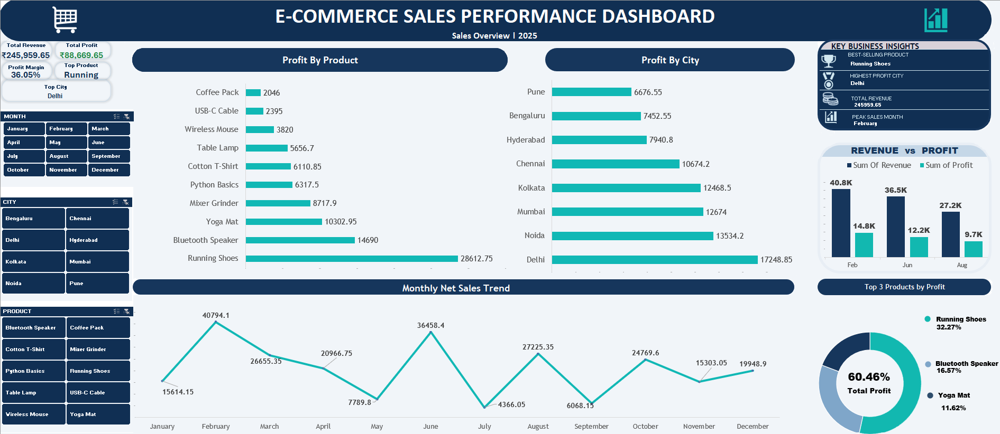

# E-Commerce Sales Performance Dashboard | Excel

## Project Overview

An interactive Excel dashboard designed to analyze e-commerce sales performance, revenue, profitability, product performance, city-wise sales, and monthly trends.

## Dashboard Preview

## Dashboard Features

- KPI cards: Total Revenue, Total Profit, Profit Margin, Top Product, and Top City

- Interactive slicers for Month, City, and Product

- Profit analysis by Product and City

- Monthly Net Sales Trend

- Monthly Revenue vs Profit comparison

- Top 3 Products by Profit

- Interactive filtering for business analysis

## Tools \& Skills

- Microsoft Excel

- PivotTables \& Pivot Charts

- Slicers

- Data Analysis

- Data Visualization

- Dashboard Design

## Key Insights

- Identifies the most profitable products

- Compares profitability across cities

- Analyzes monthly sales performance

- Highlights the contribution of top 3 products to overall profit

## Project Files

- Excel workbook containing the interactive dashboard

- Dashboard preview image

## How to Use

1. Download the Excel workbook from this repository.

2. Open it in Microsoft Excel.

3. Navigate to the Dashboard sheet.

4. Use the Month, City, and Product slicers to explore the data.

